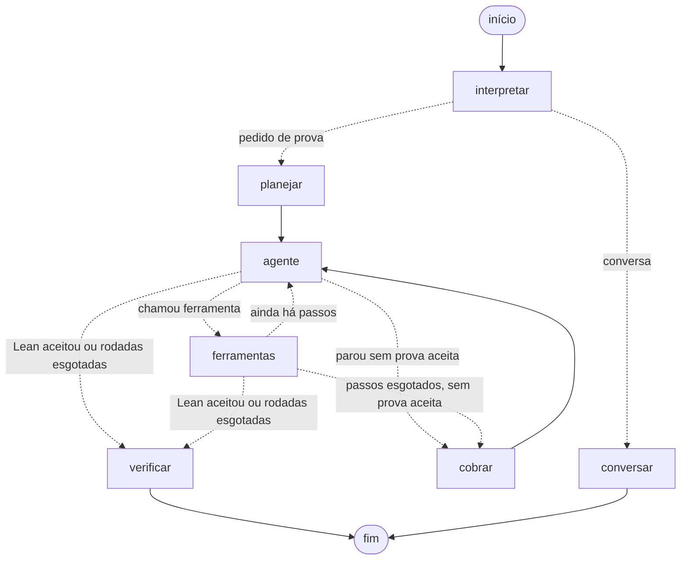

# Assistente de provas em Lean 4

**Dupla:** Vinicius Costa Soares · Matheus Vinícius Silva Freire de Castro

Trabalho da Unidade II, IA Agêntica (2026.2). O ponto de partida é o agente provador
da Unidade I ([lean_agent_pipeline.ipynb](lean_agent_pipeline.ipynb)), refeito como
grafo do LangGraph.

## O que o assistente faz e para quem

Estudantes que estão aprendendo Lean 4 pedem a prova de um teorema, em Lean ou em
português, e o assistente planeja, propõe táticas e as testa no Lean até uma prova
ser aceita ou as tentativas acabarem. Quem dá a palavra final é o Lean, não o modelo:
a resposta só diz "provado" quando o compilador aceitou a prova. Fora dos pedidos de
prova, o assistente conversa sobre Lean e sobre as provas feitas na conversa.

> **Estado atual:** o grafo, a memória por thread (checkpointer) e o laço de prova
> estão prontos. RAG agêntico, MCP, skills, guardrails e a interface em Streamlit
> ainda serão adicionados.

## Como rodar

Requisitos: Python 3.11+ e o Lean 4 instalado pelo [elan](https://github.com/leanprover/elan).

```bash
python -m venv .venv
.venv/Scripts/activate        # Windows; no Linux/macOS: source .venv/bin/activate
pip install -r requirements.txt
```

Variáveis de ambiente (ou um arquivo `.env`, que fica fora do git; veja [.env.example](.env.example)):

| variável | uso |
|---|---|
| `GROQ_API_KEY` | chave da Groq, obrigatória |
| `LEAN_AGENT_MODELO` | opcional; padrão `openai/gpt-oss-120b` |

```bash
python -m lean_agent casos            # os 10 casos de teste, com a tabela de resultados
python -m lean_agent casos TESTE7     # um caso, com o rastro das ferramentas
python -m lean_agent chat             # conversa no terminal, com memória entre turnos
python -m lean_agent grafo            # diagrama Mermaid gerado do grafo compilado
pytest                                # parser, provas de referência no Lean e arestas do grafo
```

Os testes do grafo usam um modelo roteirizado e não gastam a API.

### Notebook local

O [lean_agent_langgraph.ipynb](lean_agent_langgraph.ipynb) roda local com a chave lida da variável
de ambiente `GROQ_API_KEY`, que tem prioridade sobre o `.env`. O kernel do Jupyter herda as variáveis
do programa que o abriu, então a variável precisa existir **antes** de abrir o editor.

1. Defina a variável, de um destes jeitos:
   - **Permanente (Windows):** menu Iniciar → "Editar as variáveis de ambiente para sua conta" →
     Novo → nome `GROQ_API_KEY`, valor a chave. Feche e abra de novo o VS Code e os terminais.
     Pela janela do Windows a chave não fica no histórico do terminal.
   - **Só neste terminal (Git Bash)**, sem mostrar a chave nem gravá-la no histórico:
     ```bash
     read -rsp "GROQ_API_KEY: " GROQ_API_KEY && export GROQ_API_KEY
     ```
   - **Só neste terminal (PowerShell):**
     ```powershell
     $env:GROQ_API_KEY = [Net.NetworkCredential]::new("", (Read-Host "GROQ_API_KEY" -AsSecureString)).Password
     ```
2. Abra o notebook:
   - **VS Code** (extensões Python e Jupyter): com todas as janelas do VS Code fechadas, rode `code .`
     no terminal onde a variável foi definida (ou abra normalmente, se ela for permanente). Abra o
     notebook, clique em *Select Kernel* → `.venv\Scripts\python.exe` e depois em *Run All*.
   - **JupyterLab no navegador:** instale uma vez com `.venv/Scripts/python -m pip install jupyterlab` e
     abra com `.venv/Scripts/python -m jupyter lab lean_agent_langgraph.ipynb` no mesmo terminal.
3. Confira a saída da célula da chave: `GROQ_API_KEY lida de: variável de ambiente`.

Para rodar só alguns casos, ponha os nomes em `CASOS_ESCOLHIDOS` (seção 4 do notebook). A última
célula gera a tabela de resultados em Markdown, no formato da seção de casos de teste deste README.

## O grafo



| nó | função |
|---|---|
| `interpretar` | Decide se a mensagem pede uma prova e fixa o enunciado no estado. "Prove o teorema: …" é copiado sem passar pelo modelo; nos outros casos o modelo extrai ou formaliza o enunciado (saída estruturada). |
| `planejar` | Pede ao modelo o plano da prova (saída estruturada validada pelo Pydantic) e abre um rascunho novo com o pedido ao agente. |
| `agente` | Um passo do ReAct: o modelo lê o rascunho e chama uma ferramenta ou responde em texto. |
| `ferramentas` | `ToolNode` com `testar_tatica` (roda o Lean e devolve o erro já resumido) e `ler_guia_taticas`. |
| `cobrar` | Abre outra rodada quando o modelo parou sem o Lean aceitar nada, devolvendo o último erro. |
| `verificar` | Verifica de novo, fora do agente, a prova que o Lean aceitou e escreve a resposta final. |
| `conversar` | Responde o que não é pedido de prova, com as últimas mensagens da thread. |

A explicação completa (por que cada nó existe, quando cada aresta condicional é escolhida e um
exemplo passo a passo de um teorema percorrendo o grafo) está em [docs/grafo.md](docs/grafo.md).

### Estado

- `messages`: a conversa com o usuário (pedidos e respostas finais). É o que o
  checkpointer guarda por `thread_id`, e por isso o assistente lembra os turnos anteriores.
- `rascunho`: o ReAct do teorema atual (pedido com o plano, chamadas de ferramenta,
  erros do Lean). Zera a cada teorema, para a thread não carregar tentativas antigas e
  cada passo reenviar só o teorema atual (a Groq limita tokens por minuto).
- `enunciado`, `nome_arquivo`: vêm do harness e são injetados na ferramenta
  (`InjectedState`). O modelo só escreve a `prova`. Se ele pudesse escolher o enunciado,
  poderia testar um teorema mais fácil e receber ACEITA.
- `tentativas`, `passos`, `rodada`, `aceita`, `prova`: o controle do laço. Os limites são
  6 chamadas ao agente por rodada e 2 rodadas por teorema.

## Estrutura

```
lean_agent/
  grafo.py          estado, nós, arestas e criar_grafo()
  ferramentas.py    testar_tatica e ler_guia_taticas
  lean.py           monta o .lean e roda o compilador
  parser.py         resume o log do Lean (primeiro erro, hipóteses, objetivo)
  planejamento.py   plano da prova em saída estruturada
  modelo.py         ChatGroq e saída estruturada com plano B por prompt
  prompts.py        mensagens de sistema de cada nó
  casos.py          os 10 casos e as provas de referência
  avaliacao.py      roda os casos, mostra o rastro e o custo
docs/
  grafo.md          explicação detalhada do grafo
tests/              pytest
```

## Casos de teste

Os 10 teoremas da Unidade I estão em [lean_agent/casos.py](lean_agent/casos.py) e
rodam com `python -m lean_agent casos`. A tabela pedida na Unidade II (RAG, skills, MCP,
memória e guardrails) será preenchida quando esses componentes entrarem.
