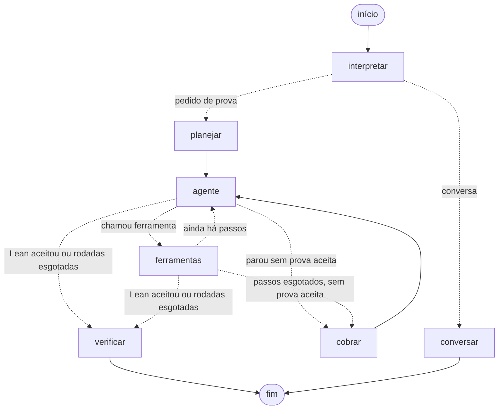

# O grafo do agente

Explicação de cada nó, das arestas e do caminho que um teorema percorre. O código está em
[lean_agent/grafo.py](../lean_agent/grafo.py). O desenho do grafo compilado sai de
`python -m lean_agent grafo` (Mermaid) ou da seção 2 do
[notebook](../lean_agent_langgraph.ipynb) (imagem).



## Como ler o desenho

- **Seta contínua:** caminho fixo. `planejar` sempre vai para `agente`, e `cobrar` sempre volta
  para `agente`.
- **Seta pontilhada:** aresta condicional. Uma função olha o estado e escolhe o próximo nó. Por
  isso `agente` e `ferramentas` têm três saídas cada.
- **Dois caminhos:** a conversa comum (`conversar`) e o agente de provas (`planejar` → `agente` ⇄
  `ferramentas` → `cobrar` / `verificar`).

## O estado

Todos os nós leem e escrevem no mesmo estado (`Estado`, um `TypedDict`):

| campo | o que guarda |
|---|---|
| `messages` | A conversa que o usuário vê: pedidos e respostas finais. O checkpointer guarda esse campo por `thread_id`, e é daí que vem a memória entre turnos. |
| `rascunho` | O trabalho do teorema atual: pedido com o plano, cada tática testada e cada erro do Lean. Zera a cada teorema, para a thread não carregar tentativas antigas e cada passo reenviar só o teorema atual (a Groq limita tokens por minuto). |
| `intencao` | `"provar"` ou `"conversa"`, decidido por `interpretar`. |
| `enunciado` | O teorema a provar, fixado pelo grafo e não pelo modelo. |
| `nome_arquivo` | O `.lean` deste teorema, um por thread, para duas conversas não sobrescreverem o arquivo uma da outra. |
| `plano` | O plano formatado, ou vazio se o modelo não conseguiu gerá-lo. |
| `tentativas` | Uma entrada por chamada a `testar_tatica`: a prova, se foi aceita, o erro e a resposta devolvida ao modelo. |
| `passos` | Chamadas ao `agente` na rodada atual. O limite é `MAX_PASSOS = 6`. |
| `rodada` | Rodada atual. O limite é `MAX_RODADAS = 2`. |
| `aceita`, `prova` | O veredito final, escrito por `verificar`. |

## Os nós

### `interpretar`: o que o usuário quer?

É a porta de entrada de toda mensagem. Decide se ela pede uma prova e, se pedir, qual é o
enunciado em Lean.

- "Prove o teorema: …" (regex `PEDIDO_EXPLICITO`) tem o enunciado copiado direto, sem passar pelo
  modelo, que poderia reescrevê-lo.
- Nos outros casos, o modelo classifica a mensagem com saída estruturada (`Pedido`) e formaliza o
  pedido. Ele vê as últimas `JANELA_CONVERSA = 8` mensagens, para resolver referências como "o
  mesmo para listas". "Prove que p ∧ q implica q ∧ p", por exemplo, vira
  `(p q : Prop) : p ∧ q → q ∧ p`.
- Quando é pedido de prova, zera tudo o que era do teorema anterior: `tentativas`, `passos`,
  `rodada`, `plano`, `aceita` e `prova`.

**Por que existe:** é aqui que o enunciado fica preso no estado. Daqui para frente, o modelo só
escreve táticas. A ferramenta `testar_tatica` recebe o enunciado do estado (`InjectedState`), e
não de um argumento. Se o modelo pudesse escolher o enunciado, poderia trocar o teorema por um
mais fácil e receber "ACEITA".

**Sai para:** `planejar` se for pedido de prova, `conversar` se não for (`rotear_intencao`).

### `conversar`: o que não é prova

Responde dúvidas como "o que faz a tática omega?" ou "qual tática você usou na prova anterior?". O
modelo vê as últimas 8 mensagens da thread, então lembra das provas feitas antes, e a resposta vai
direto para o fim.

**Por que existe:** nem toda mensagem é pedido de prova. É o ponto onde o RAG e as skills vão
entrar.

### `planejar`: pensar antes de tentar

Pede ao modelo um **plano da prova** em saída estruturada (`Plano`). É uma lista de passos, cada
um com a instrução, a tática provável e o resultado esperado no objetivo. O Pydantic valida o
formato, e um plano com menos de `MIN_PASSOS = 2` passos é descartado.

O plano vira texto e abre um `rascunho` novo junto com o pedido:

```
Prove o teorema: (a b : Nat) : a + b = b + a

PLANO DA PROVA (siga na ordem; se um passo se mostrar impossível, diga qual e proponha outro caminho):
1. Introduzir as variáveis a e b | tática provável: intro | espera: ...
2. Fazer indução sobre a | tática provável: induction | espera: ...
```

Se o modelo não conseguir gerar o plano, a prova segue sem ele, só com o feedback do Lean.

**Por que existe:** sem plano, o modelo tende a chutar táticas soltas. Com plano, cada tentativa
tem uma intenção, e quando o Lean recusa, o modelo sabe em que passo travou. É o planejamento da
aula 06, numa etapa fixa que roda uma vez por teorema.

**Sai para:** `agente`, sempre.

### `agente`: um passo do ReAct

O modelo, com as ferramentas ligadas, lê o `rascunho` inteiro e faz uma de duas coisas:

- **Chama uma ferramenta**, geralmente `testar_tatica(prova="...")`.
- **Responde em texto.** Normalmente é a explicação depois de uma prova aceita, ou "não consegui,
  travei em X".

Cada passagem soma 1 em `passos`. O limite de 6 por rodada também é um limite de gasto, porque
cada passo reenvia o rascunho todo à API.

**Sai para** (`depois_do_agente`): `ferramentas` se o modelo chamou uma ferramenta; se não, a
decisão de fim de rodada (`fim_da_rodada`) escolhe entre `cobrar` e `verificar`.

### `ferramentas`: onde o Lean entra

Um `ToolNode` que executa a ferramenta pedida e escreve a resposta no `rascunho`:

- **`testar_tatica`**: monta o `.lean` com as definições, o enunciado do estado e as táticas do
  modelo, roda o compilador e devolve `ACEITA` ou `RECUSADA`. Quando recusa, o parser já resume o
  log em mensagem, hipóteses e objetivo (⊢). Cada chamada vira uma entrada em `tentativas`.
- **`ler_guia_taticas`**: devolve o guia de sintaxe do `GuiaLean4.md`. Hoje esse arquivo não está
  no repositório, e a ferramenta responde "Guia não encontrado".

O vaivém `agente` ⇄ `ferramentas` é o laço "propõe → testa → lê o erro → corrige".

**Sai para** (`depois_das_ferramentas`): `agente` enquanto houver passos na rodada; se não, a
decisão de fim de rodada.

### `cobrar`: o modelo não decide que acabou

Entra quando a rodada termina **sem nenhuma prova aceita pelo Lean**. Há duas situações:

- O modelo respondeu em texto, desistindo ou afirmando que terminou.
- Os 6 passos acabaram.

O nó acrescenta ao rascunho uma mensagem do próprio grafo:

```
O Lean ainda não aceitou nenhuma prova, então a tarefa não terminou.
Último resultado de testar_tatica:
RECUSADA (erro_compilacao) ...
Continue: proponha outra prova e teste com testar_tatica.
```

Depois abre a rodada seguinte: `rodada` + 1, `passos` volta a 0 e o rascunho é mantido, para o
modelo não repetir o que já falhou.

**Por que existe:** modelos às vezes dizem "pronto, provado" sem o Lean ter aceitado nada, ou
desistem cedo. Quem decide se acabou é o grafo olhando as `tentativas`, não o texto do modelo. A
cobrança acontece no máximo `MAX_RODADAS - 1` vezes, o que limita o custo.

**Sai para:** `agente`, sempre.

### `verificar`: a palavra final é do Lean

Último nó do caminho de prova. Ele:

1. Pega a primeira prova que o Lean aceitou (`primeira_aceita`).
2. **Roda o Lean de novo** nela, fora do agente. Assim, nenhuma falha no registro das tentativas
   faz uma prova errada passar como certa.
3. Escreve a resposta final em `messages`:
   - **com prova aceita:** "Teorema `X` provado e verificado pelo Lean", o código exato que o Lean
     aceitou e a explicação do agente;
   - **sem prova aceita:** "Não consegui uma prova de `X` que o Lean aceitasse (N prova(s)
     testada(s) em R rodada(s))", o último erro do Lean e o que o agente disse.

O código mostrado ao usuário vem das `tentativas`, não do texto do modelo. O prompt do agente pede
que ele não repita a prova, porque ele poderia reescrevê-la diferente da versão aceita.

**Limitação atual:** nos casos falsos (TESTE6 e TESTE10), "Não consegui" é o resultado esperado,
mas o agente só chega lá falhando. A ferramenta `testar_negacao` da Unidade I, que prova a negação
do enunciado, ainda não foi trazida para o grafo. Com ela, `verificar` poderia responder "o
teorema é falso" com uma refutação verificada pelo Lean.

**Sai para:** o fim.

## As arestas condicionais de `agente` e `ferramentas`

| sai de | quando | vai para |
|---|---|---|
| `agente` | o modelo pediu uma ferramenta | `ferramentas` |
| `agente` | respondeu em texto, sem prova aceita, na 1ª rodada | `cobrar` |
| `agente` | respondeu em texto, e o Lean já aceitou uma prova ou é a 2ª rodada | `verificar` |
| `ferramentas` | ainda restam passos na rodada | `agente` |
| `ferramentas` | os 6 passos acabaram, sem prova aceita, na 1ª rodada | `cobrar` |
| `ferramentas` | os 6 passos acabaram, e o Lean aceitou ou é a 2ª rodada | `verificar` |

A escolha entre `cobrar` e `verificar` é sempre a mesma função, `fim_da_rodada`: vai para
`verificar` se há prova aceita ou se as rodadas acabaram, e para `cobrar` nos outros casos.

Se o modelo pede uma ferramenta, ela **sempre** é executada, mesmo no último passo. Uma chamada
sem resposta no rascunho faria a API recusar o pedido seguinte.

Depois de um `ACEITA`, o grafo não para na hora. Se ainda há passos, volta ao `agente` para ele
explicar a prova em texto, e só então segue para `verificar`.

## Exemplo: o TESTE1 numa execução do notebook

Os passos variam de uma execução para outra. Nesta, o agente precisou de cinco tentativas:

1. **interpretar** recebe "Prove o teorema: (a b : Nat) : a + b = b + a" e copia o enunciado sem
   chamar o modelo.
2. **planejar** gera um plano de 8 passos: intro, indução em `a`, `simp` no caso base, e assim por
   diante.
3. **agente → ferramentas**, quatro vezes: quatro variações de indução com `simp`, todas
   `RECUSADA`. Cada erro, com o objetivo que faltava, voltou ao modelo.
4. **agente → ferramentas**, pela 5ª vez: `simpa using Nat.add_comm a b`, `ACEITA`.
5. **agente**, na 6ª passagem, responde em texto explicando que usou o lema `Nat.add_comm`.
6. A resposta foi em texto e há prova aceita, então o grafo vai para **verificar**, que roda o
   Lean de novo, confirma e escreve a resposta final na conversa.

O `cobrar` não apareceu porque a prova saiu na 1ª rodada. Num caso falso como o TESTE6, o caminho
seria `agente` ⇄ `ferramentas` até esgotar a rodada, depois `cobrar`, mais uma rodada inteira e
por fim `verificar` com "Não consegui".
